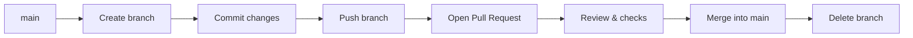

# 05 — Git, GitHub Flow & Advanced Git  
   
  
  
   
Version control is the base of every DevOps workflow: infrastructure code, CI/CD pipelines and GitOps all start with Git. This module covers the daily workflow (**GitHub Flow**) and the advanced tools needed to fix mistakes and keep a clean history.  
   
## Objectives  
   
- Work safely in a team workflow: branches, pull requests, reviews, merges  
- Keep a clean, readable history  
- Resolve conflicts without panic  
- Recover from mistakes (wrong commit, lost work, bad merge)  
- Know when to use `merge`, `rebase`, `reset` and `revert`  
   
---  
   
## 1. Mental model  
   
```text  
Working directory ──git add──▶ Staging area ──git commit──▶ Local repo ──git push──▶ Remote (GitHub)  
        ◀──────────── git restore ────────────      ◀──────────── git fetch / pull ────────────  
```  
   
| Area | Role |  
|---|---|  
| Working directory | Files as I edit them |  
| Staging area (index) | What will go into the next commit |  
| Local repository | Full history on my machine |  
| Remote | Shared copy on GitHub (`origin`) |  
   
---  
   
## 2. GitHub Flow  
   
A lightweight workflow: `main` is always deployable, and all work happens in short-lived branches.  
   

   
### Steps  
   
```bash  
git switch main && git pull                 # 1. start from an up-to-date main  
git switch -c feature/short-description     # 2. create a branch  
# ...edit files...  
git add <files>                             # 3. stage  
git commit -m "feat: add backup script"     # 4. commit  
git push -u origin feature/short-description # 5. push and set upstream  
# 6. open a Pull Request on GitHub, review, merge  
git switch main && git pull                 # 7. sync after the merge  
git branch -d feature/short-description     # 8. delete local branch  
git push origin --delete feature/short-description   # 9. delete remote branch  
git fetch --prune                           # 10. clean stale remote references  
```  
   
### Conventions  
   
| Topic | Rule |  
|---|---|  
| Branch names | `feature/…`, `fix/…`, `docs/…`, `chore/…` |  
| Commit messages | [Conventional Commits](https://www.conventionalcommits.org/): `feat:`, `fix:`, `docs:`, `refactor:`, `chore:` |  
| Commit size | One logical change per commit |  
| Pull Requests | Clear title, short description of what and why, small scope |  
| `main` | Never commit directly: protected by a branch rule (Settings → Branches) |  
   
---  
   
## 3. Everyday commands  
   
| Goal | Command |  
|---|---|  
| Status of files | `git status` |  
| See unstaged / staged changes | `git diff` / `git diff --staged` |  
| Compact history graph | `git log --oneline --graph --decorate --all` |  
| Who changed this line | `git blame <file>` |  
| Fix the last commit message or content | `git commit --amend` |  
| Ignore files | add patterns to `.gitignore` |  
   
---  
   
## 4. Advanced Git  
   
### 4.1 Merge vs rebase  
   
| | `git merge` | `git rebase` |  
|---|---|---|  
| Result | Merge commit, history preserved as it happened | Linear history, commits replayed on top |  
| Use for | Integrating a finished branch into `main` | Updating my own feature branch with latest `main` |  
| Risk | Noisy history | Rewrites commits |  
   
```bash  
git switch feature/x  
git rebase main              # replay my commits on top of main  
git rebase --continue        # after resolving a conflict  
git rebase --abort           # cancel and return to the previous state  
```  
   
> **Golden rule:** never rebase commits that other people already pulled (shared branches, `main`).  
   
If a rebased branch was already pushed, use `git push --force-with-lease` (safer than `--force`) and only on my own branch.  
   
### 4.2 Resolving merge conflicts  
   
```text  
<<<<<<< HEAD  
my version  
=======  
their version  
>>>>>>> feature/x  
```  
   
1. `git status` to list conflicted files  
2. Edit each file, keep the correct content, remove the markers  
3. `git add <file>`  
4. `git commit` (merge) or `git rebase --continue` (rebase)  
   
### 4.3 Undoing things  
   
| Situation | Command | Safe on shared history? |  
|---|---|---|  
| Discard changes in a file | `git restore <file>` | n/a |  
| Unstage a file | `git restore --staged <file>` | n/a |  
| Undo last commit, keep changes staged | `git reset --soft HEAD~1` | No |  
| Undo last commit, keep changes unstaged | `git reset --mixed HEAD~1` | No |  
| Undo last commit and discard changes | `git reset --hard HEAD~1` ⚠️ | No |  
| Undo a commit by creating the opposite commit | `git revert <sha>` | **Yes** |  
   
**Rule:** `reset` rewrites history (local only). `revert` adds a new commit (safe for pushed history).  
   
### 4.4 Stash  
   
```bash  
git stash push -m "wip: script"   # save uncommitted work  
git stash list  
git stash pop                     # restore and drop  
git stash apply                   # restore and keep  
```  
   
### 4.5 Cherry-pick  
   
```bash  
git cherry-pick <sha>             # apply one commit to the current branch  
```  
   
### 4.6 Interactive rebase (clean up before a PR)  
   
```bash  
git rebase -i HEAD~3              # squash, reword, reorder, drop the last 3 commits  
```  
   
### 4.7 Reflog: recovering "lost" work  
   
```bash  
git reflog                        # every position HEAD has been at  
git reset --hard <sha>            # return to a previous state  
```  
   
### 4.8 Tags and releases  
   
```bash  
git tag -a v1.0.0 -m "First release"  
git push origin v1.0.0  
```  
   
### 4.9 Finding a bug with bisect  
   
```bash  
git bisect start  
git bisect bad                    # current commit is broken  
git bisect good <sha>             # this one was fine  
# Git checks out commits to test; answer good/bad until it finds the culprit  
git bisect reset  
```  
   
---  
   
## 5. Labs  
   
> Tick a box only when the lab is done, and link the evidence (commit, PR or notes).  
   
| # | Lab | Done | Evidence |  
|---|---|---|---|  
| 1 | Create a feature branch, push it, open a PR, merge, delete the branch | ☐ | |  
| 2 | Protect `main` and require a pull request | ☐ | |  
| 3 | Create and resolve a merge conflict on purpose | ☐ | |  
| 4 | Rebase a feature branch onto an updated `main` | ☐ | |  
| 5 | Squash 3 commits with `git rebase -i` | ☐ | |  
| 6 | Undo a pushed commit with `git revert` | ☐ | |  
| 7 | Recover a deleted commit with `git reflog` | ☐ | |  
| 8 | Use `git stash` to switch tasks mid-work | ☐ | |  
| 9 | Cherry-pick a fix from one branch to another | ☐ | |  
| 10 | Create an annotated tag and a GitHub release | ☐ | |  
| 11 | Locate a bug with `git bisect` | ☐ | |  
   
---  
   
## 6. Troubleshooting log  
   
| Problem | Cause | Fix |  
|---|---|---|  
| `rejected: non-fast-forward` on push | Remote has commits I don't have | `git pull --rebase`, then push |  
| Committed to `main` by mistake | Forgot to branch | `git branch feature/x`, `git reset --hard origin/main`, `git switch feature/x` |  
| Committed a secret | Added a token or key to a commit | Rotate the secret **first**, then clean history; deleting the file is not enough |  
| *(add my own cases here)* | | |  
   
---  
   
## 7. Key takeaways  
   
- `main` stays clean and deployable; all work happens on short-lived branches  
- Small commits with clear messages make reviews and reverts easy  
- Rewriting history is fine locally, forbidden on shared branches  
- `reflog` makes most mistakes recoverable  
   
## Resources  
   
- [Pro Git book (official, free)](https://git-scm.com/book)  
- [GitHub Flow guide](https://docs.github.com/en/get-started/using-github/github-flow)  
- [Git documentation](https://git-scm.com/doc)  
